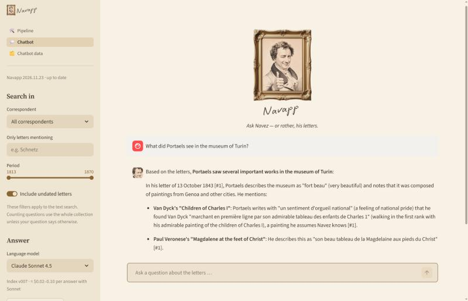

<p align="center">
  
</p>

<p align="center"><i>Ask Navez — or rather, his letters.</i></p>

# Navapp

Navapp is a Streamlit app for the correspondence of the Belgian painter François-Joseph Navez (1787–1869),
built for the Navez Project at GhentCDH. It takes letters from scan to searchable source: handwritten text
recognition, named entities, person clusters and links to the nodegoat person list, and a chatbot that
answers questions about the letters with citations, or with exact counts from the nodegoat metadata.

<p align="center">
  
</p>

The app has three pages:

| Page | What it does |
|---|---|
| **Pipeline** (`pipeline_app.py`) | Turns letter scans into transcriptions, entities, person clusters and links to the nodegoat person list, then sends the letters to the chatbot. |
| **Chatbot** (`navapp_pages/chat.py`) | Answers questions about the letters with cited sources (Dutch, English or French). Counting questions use the nodegoat metadata. Conversations are saved, and facts a researcher corrects are remembered in later answers. |
| **Chatbot data** (`navapp_pages/chat_data.py`) | Manages uploaded letters, imports the person corrections made in OpenRefine, shows and edits what the chatbot remembers, loads a new nodegoat export and rebuilds the index. |

How the pipeline works, and which data and metadata the chatbot database holds, is described in
[docs/pipeline_en_database.md](docs/pipeline_en_database.md) (in Dutch).

## Layout

```
navapp.py                  entry point (st.navigation over the three pages)
pipeline_app.py            pipeline page
navapp_pages/              chatbot pages
HTR_pipeline/              Claude Opus HTR (prompt and helpers), KBR IIIF download
NER_pipeline/              d'AlemBERT inference
CLUSTERING_pipeline/       clustering rule, person linking, LLM shared-surname check
chatbot/rag/               retrieval (FTS5 + embeddings + reranker), statistics, agent with tools
chatbot/scripts/           build corpus and index, command-line questions, evaluations
chatbot/app/               standalone Chainlit version of the chatbot
tools/                     build the desktop package for Fien, export code to this repo
assets/, .streamlit/       logo and theme
```

The folder layout mirrors the Navez research repo, because the modules find each other through paths relative
to the repo root.

## Data and model (not in this repo)

The repo holds code only. Before the app runs, these files must be put in place (copy them from the research
repo or from the desktop package in `dist/navapp`):

| Path | Contents |
|---|---|
| `NER_pipeline/ckpts/dalembert_fold2/checkpoint-450/` | fine-tuned d'AlemBERT model (~420 MB) |
| `NER_pipeline/eval/gold_561_merged.jsonl` | gold file the label order is rebuilt from |
| `CLUSTERING_pipeline/glossary/PERSON_export_2708.csv` | nodegoat person list |
| `CLUSTERING_pipeline/pilot50_gold.csv` | pilot gold set used by the linking module |
| `data/letters_overview.csv` | letter metadata (sender, recipient, date, KBR IDN) |
| `data/ner_corpus/per_mentions_openrefine.csv` | corpus person mentions (duplicate check, linking prior) |
| `data/nodegoat_export_2106.csv` | nodegoat letter export for counting questions |
| `chatbot/data/corpus/letters.jsonl` | chatbot corpus (or rebuild it with `chatbot/scripts/build_corpus.py`) |
| `chatbot/data/index/` | chatbot index (or rebuild it with `chatbot/scripts/build_index.py`) |
| `config/key_openrouter.txt` | OpenRouter API key (or paste it in the app under Settings) |

All of these paths are listed in `.gitignore`, so they cannot be committed by accident.

## Running

```powershell
python -m venv .venv
.venv\Scripts\python.exe -m pip install -r requirements.txt
.venv\Scripts\python.exe -m streamlit run navapp.py
```

On Windows, `start_navapp.bat` does the last step. The reranker
(`cross-encoder/mmarco-mMiniLMv2-L12-H384-v1`) is downloaded from Hugging Face on first use.

## Updates

Installed copies of Navapp check `navapp_version.json` in this repo at start-up (and then hourly). When a newer
version is out, the sidebar shows what is new and an **Install the update** button. The updater
(`navapp_update.py`) replaces code only; the user's data in `chatbot/data`, the model, the person list and the
key are never touched, and replaced files are kept in `_backup/`.

Development happens in the Navez research repo. After a change there:

```powershell
python tools/export_navapp_repo.py --release "What is new, in one sentence"
```

Then commit and push here. Without `--release` the code is updated but installed copies get no notice.
